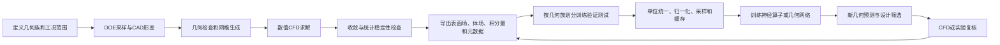

# AI CFD 企业、论文与高保真数据流程

检索截止：2026-09-28。本文把用户所说的 Luminary 解释为 Luminary Cloud（现官网 luminary.ai），physicnemo 解释为 NVIDIA PhysicsNeMo，并追溯 Modulus / SimNet。根据补充要求，扩展到其他企业和必要的学术数据集。具体下载成功数、失败项与论文链接以本目录的 `README.md`、`论文索引.md` 和 `manifest.csv` 为准。

**最重要的结论：工程 AI CFD 的核心资产通常是经过验证的数值仿真数据和自动化生产流程。神经网络学习这些数据，但“高保真”在不同资料中可能指稳态 RANS、瞬态 DDES/混合 RANS–LES，或只指较细的网格，不能视为同一精度标准。**

## 1. 哪些企业在做，分别提供什么

以下是有一手资料支持的企业样本，不是全球所有企业的穷尽名录。企业官网列出的合作研究不一定全部由企业独立完成；高校方法也不等于企业产品。

| 企业／团队 | 主要角色 | 可追溯的论文或资料 | 数据来源与公开程度 |
|---|---|---|---|
| NVIDIA | 开源训练框架、神经算子、分布式计算 | SimNet、GINO、DoMINO、FIGConvNet、X-MeshGraphNet、GeoTransolver；[官方研究目录](https://docs.nvidia.com/physicsnemo/latest/physicsnemo/research.html) | 使用 DrivAerML、SHIFT 等外部数据，也有内部 DriveSim；不是所有数据都由 NVIDIA 生成 |
| Luminary | GPU CFD 求解器、网格自适应、批量数据生产、SHIFT 模型 | 两篇 AIAA 求解／优化论文；[SHIFT 数据集目录](https://huggingface.co/luminary-shift) | SUV、Wing、Pump、Battery 等有公开数据说明；原始文件当前存在访问申请条件 |
| Emmi AI | 大规模 CFD 代理模型、Noether 框架 | AB-UPT、SHIFT 技术报告、Emmi-Wing、NeuralDEM、UPT 等；[研究目录](https://www.emmi.ai/research) | 既使用 Luminary / DrivAerML 数据，也自己构建 Emmi-Wing；早期合作工作单独标作研究谱系 |
| PhysicsX | 专有数据工厂、几何基础模型和物理预训练模型 | [PXNetCar 数据工厂](https://www.physicsx.ai/newsroom/scaling-physics-ai-for-automotive-aerodynamics)、[PX-Car-Aero-v1](https://www.physicsx.ai/newsroom/scaling-physics-ai-for-automotive-aerodynamics-part-ii-meet-px-car-aero-v1) | 多基准车型、大规模 STAR-CCM+ 数据；细节来自公司技术文章，未将其冒充同行评审论文 |
| Neural Concept | 几何深度学习、场预测、设计优化 | Geodesic Convolutional Shape Optimization、DEBOSH、迭代网络不确定性；[DrivAerNet++ 案例](https://www.neuralconcept.com/post/from-dataset-to-design-impact-how-neural-concept-set-a-new-benchmark-on-mits-drivaernet) | 公开基准和客户数据；该案例的详细白皮书需申请，未公开的训练细节不能反推 |
| BeyondMath | 工程物理 AI、非定常流动建模 | [GRaM 2026 / Warped-IFW](https://proceedings.mlr.press/v326/suk26a.html) | 共同发布 181 个前翼形变算例的分离涡流动数据；应区分比赛基准和商业模型能力 |
| Siemens | CFD 求解、工程数据分析、PhysicsAI / ROM | Demystifying the Data Need of ML-surrogates for CFD Simulations；[2026 PhysicsAI 发布](https://news.siemens.com/en-us/siemens-simcenter-physicsai/) | 用 STAR-CCM+ 和既有仿真结果训练代理，再用 CFD 验证 |
| Ansys | Fluent 等求解器和 SimAI 平台 | [SimAI 产品](https://www.ansys.com/en-gb/products/ai/simai)、[数据导入文档](https://ansyshelp.ansys.com/public/Views/Secured/SimAI/v000/en/SimAI_ug/SimAI_ug/C_UG_SAI_data_upload.html) | 支持不同厂商的历史仿真数据；商业模型内部实现未完整公开 |
| NAVASTO | NAVPACK 等工程代理建模 | [与 Rescale 的工作流](https://rescale.com/resources/ai-physics-end-to-end-workflow-demo/) | STAR-CCM+ 批量 DOE → NAVPACK 训练 → 新设计推断 → 原求解器复核 |
| SimScale | 云端 CFD 与 AI 部署平台 | [与 NAVASTO 的集成](https://www.simscale.com/blog/turbomachinery-design-ai-simulation/) | 让 CFD 与 GNN 预测在同一工作台并行使用；与模型开发企业是合作关系 |
| AWS / CAE-ML 合作团队 | 算力、开放工业 CFD 数据 | DrivAerML、AhmedML、WindsorML | 重要的数据基础设施参与者；不能把它们都当成 AWS 独立开发的商业代理求解器 |
| Google DeepMind | 通用物理学习方法 | [Learning Mesh-Based Simulation with Graph Networks](https://arxiv.org/abs/2010.03409) | MeshGraphNets 是很多后续方法的基础；与可直接采购的工业 CFD 产品应分开看 |

## 2. 数据生产和模型训练的共同流程

这是对多份资料的归纳，不意味着每个项目都公开或执行了图中的全部步骤。尤其应分别核查：数值收敛、网格敏感性、时间平均误差和实验验证。残差下降只能证明求解过程的一部分。

## 3. Luminary：如何生成和导出训练数据

### SHIFT-SUV

基于 FKFS AeroSUV，通过形变笼和 Latin hypercube sampling 生成变体；区分 estate / fastback，以及全尺寸和四分之一尺寸。公开数据对应瞬态 DDES，保存最终时刻与时间平均的表面压力、壁面剪切应力、体压力和速度，另存力系数与残差时间历史。格式为 STL、VTP、VTU、CSV。[官方数据卡](https://huggingface.co/datasets/luminary-shift/SUV)

当前卡片给出的全尺寸平均窗口为最后 15,000 步、2.67 s；四分之一尺寸为最后 6,000 步、0.277158 s。两组的速度、时间步长和参考面积不同，不能合并后只按文件名训练。早期发布说明的 1,000 个样本、后续论文使用的约 4,000 个算例和未来扩充目标属于不同版本，不能混算。[数据卡更新说明与条件](https://huggingface.co/datasets/luminary-shift/SUV/blob/main/README.md)

### SHIFT-Wing

把 NASA CRM 翼型在六个展向截面参数化，通过平移、缩放、扭转后重新放样得到新几何。使用稳态 RANS 和 Luminary Mesh Adaptation。数据卡说明默认经历 13 级网格序列，约从 25 万到 3,000 万单元；还提供约 20 万顶点的独立 CAD 表面表示。输出表面压力／剪切应力、体速度／压力／密度／温度／涡黏度，以及力、力矩和工况参数。[官方数据卡](https://huggingface.co/datasets/luminary-shift/WING)、[AB-UPT 技术报告 §3.4–3.5](https://arxiv.org/abs/2510.15808)

**关键处理问题是输入网格可能泄露解的信息。** 自适应网格已经根据激波位置调整过；把这种网格当成推断时随手可得的几何输入，会高估实际使用能力。AB-UPT 的专门实验把几何输入／表面锚点改成独立 CAD 网格，体锚点用规则网格，而监督查询点仍取 CFD 网格，只在有标签的查询点计算损失。[同一报告 §3.5.4](https://arxiv.org/abs/2510.15808)

### SHIFT-Pump 与 SHIFT-Battery

Pump 当前数据卡描述 5,600 多个几何／工况配置：参数曲线形成叶片与蜗壳，建立含边界层的网格，设置旋转叶轮域与静止蜗壳域；存储表面场、体场、参数、仿真 ID 和扭矩等结果。卡片同时使用“固定网格、旋转参考系、sliding interface”等表述，因此仅凭卡片不能认定具体时间推进和接口实现。也不能把所有配置数直接等同于不同几何数。[Pump 数据卡](https://huggingface.co/datasets/luminary-shift/Pump)

Battery 当前有 1,300 多个几何与工况组合，生成蛇形冷板通道，计算水–乙二醇流体与固体板、TIM 间的共轭传热。其样本保留几何、温度／热流／压力、体流场、热源与质量流量参数，以及压降和最高温度。一个几何在不同工况下计算会计为多个配置。[Battery 数据卡](https://huggingface.co/datasets/luminary-shift/Battery)

这些数据卡仍写着数据集论文正在准备中。它们可以作为可引用数据记录，但不能虚构一篇同名正式论文。其他 SHIFT 产品的公开说明会保存到 `sources/`；资料目录与论文目录分开计数。

### 从数值标签走向实验校正

Luminary 2026 年 6 月的技术文章描述了额外的校正流程：把风洞压力敏感涂料（PSP）测量配准到 CFD 网格，用 Gaussian Process 补齐测量缺口；先用约 2,300 个 CFD 算例训练 GeoTransolver，再冻结主模型，仅训练一个轻量网络拟合实验与仿真的差异。它说明仿真标签的一致性与对真实物理的准确性需要分别检验。此处是公司技术说明，未检索到对应独立论文；文章的几何命名与跨音速条件存在需要进一步澄清之处，因此不据此扩写具体验证构型。[官方说明](https://luminary.ai/resources/why-physics-ai-models-need-to-be-anchored-to-reality/)

另外补入两篇有 Luminary 作者参与的流场处理研究：神经粒子追踪用于已有时变流场的快速可视化，以及分布式粒子平流的性能分析。这类工作影响海量 CFD 结果的存储、读取和后处理，不能当作 SHIFT 代理模型或其数据生成论文。[神经粒子追踪](https://arxiv.org/abs/2312.14973)、[分布式粒子平流](https://arxiv.org/abs/2410.09710)

## 4. PhysicsNeMo：如何把 CFD 结果变成训练数据

PhysicsNeMo 既支持物理约束方法，也支持有监督代理；早期 SimNet 的一些算例可以通过 PDE 残差训练，不要求大型 CFD 标签集。现代 DoMINO / GeoTransolver 的工业代理实验则大量依赖已有数值仿真数据。不能把两条路线合并成“PhysicsNeMo 自己产生所有高保真数据”。[SimNet](https://arxiv.org/abs/2012.07938)、[DoMINO](https://arxiv.org/abs/2501.13350)

DoMINO 原论文使用 DrivAerML 的时间平均表面场与体场。保留高分辨率数据，在车体附近裁剪计算区域；训练时每轮重采样监督点，表面按面积加权、体域随机抽样，并编码几何和局部邻域。原文所谓没有下采样不能理解为每次训练都同时处理整张亿级网格；它与每轮在线采样并不矛盾。[DoMINO §3](https://arxiv.org/abs/2501.13350)

在当前本地仓库中，还能具体找到以下处理步骤。它们是代码检查结果，不能不加区分地追溯成 2025 年原论文的配置：

| 步骤 | 本地实现 | 作用 |
|---|---|---|
| 读取原始场 | `physicsnemo/datapipes/cae/readers.py` | 读取 VTP、VTU、CGNS、STL |
| 字段与全局条件映射 | `examples/cfd/external_aerodynamics/domino/src/conf/config.yaml` | 示例字段包括 `pMeanTrim`、`wallShearStressMeanTrim`、`UMeanTrim`、`nutMeanTrim`；声明速度与密度参考值 |
| ROI、坐标与几何特征 | `physicsnemo/datapipes/cae/domino_datapipe.py` | bounding box 裁剪、坐标归一化、表面邻域、SDF 与最近表面点 |
| 标签缩放 | 同上 `scale_model_targets()` | 支持 mean/std 或 min/max；反归一化使用同一套统计量 |
| 统计量生成 | `examples/cfd/external_aerodynamics/domino/src/compute_statistics.py` | 计算字段和坐标统计量，保存 `scaling_factors.pkl` |
| 在线采样 | 示例 `config.yaml` | 当前示例为表面 8,192 点、体域 8,192 点、几何 300,000 点；是可配置示例值，不是通用要求 |
| 加速读取 | `cache_data.py`、`shuffle_volumetric_curator_output.py` | 缓存预处理结果、处理 Zarr 数据布局，降低重复 I/O |
| 工程评价 | `loss.py` 与推断流程 | 从压力和剪切应力评价积分载荷，不能只看逐点误差 |

**实践判断：**应先确定按几何划分的训练集，再只在训练集上计算归一化统计量。上述统计脚本使用 `cfg.data.input_dir`，所以输入目录的边界要由使用者正确配置。还要核对 OpenFOAM 的运动学压力与物理压力、法向朝向、剪切应力符号、参考面积和参考速度；这些不能靠标准化自动修正。

另一条路线是以 AI 预测场初始化传统 CFD，再由求解器继续推进。这能减少启动时间，但仍需检查质量守恒、边界条件及后续统计收敛；RANS 预测均值也不能直接视作正确的瞬态湍流状态。[Accelerating Transient CFD through Machine Learning-Based Flow Initialization](https://arxiv.org/abs/2503.15766)

## 5. 其他企业的数据路线

### Emmi AI

Emmi-Wing 用 NACA0012 构造三维机翼，联合采样四个几何参数与速度、迎角，形成 29,727 个算例。论文公开 OpenFOAM-v2506、`rhoSimpleFoam`、Spalart–Allmaras 和 `snappyHexMesh`。这是稳态可压缩 RANS；论文写出的 y+ 为 50–200，不能解读为 y+≈1 的壁面解析网格。其评估分别考察随机、插值和外推测试。[Emmi-Wing §2](https://arxiv.org/abs/2511.21474)

AB-UPT 将几何、表面、体域分支及锚点／查询点分开处理，支持高分辨率场的分块推断。SHIFT 技术报告为缓解读取瓶颈，将体数据离线随机保留 10%，再进行训练采样。这与 DoMINO 原文强调保留全分辨率数据、每轮在线采样的策略不同；二者不应笼统写成同一种“点云降采样”。[AB-UPT](https://arxiv.org/abs/2502.09692)、[SHIFT 技术报告](https://arxiv.org/abs/2510.15808)

### PhysicsX

公开数据工厂流程为：筛选和修补不同基准车型 → Blender 定义有工程意义的局部形变 → LHS → STAR-CCM+ 自动网格和稳态 k–ω SST RANS → 收敛与物理场范围检查 → 表面简化后再检查。2026 年 3 月资料记录 20,486 个算例、260 个基准车型，速度固定 30 m/s。[数据工厂技术文章](https://www.physicsx.ai/newsroom/scaling-physics-ai-for-automotive-aerodynamics)

2026 年 8 月资料更新为 444 个基准车型、33,203 个仿真设计；仍为 RANS 预训练，并讨论向 DES 数据微调。它的可借鉴点是按整个基准车型留出测试集，另外考察求解设置迁移；同一车型变形后的随机划分不能证明跨车型泛化。[PX-Car-Aero-v1 技术文章](https://www.physicsx.ai/newsroom/scaling-physics-ai-for-automotive-aerodynamics-part-ii-meet-px-car-aero-v1)

LGM-Aero 的“2,500 万”指几何网格预训练语料，而不是 2,500 万次高保真 CFD。几何清洗与有物理标签的 CFD/FEA 数据生产属于两个阶段。[LGM-Aero 技术文章](https://www.physicsx.ai/newsroom/building-beyond-human-imagination-with-foundation-models-for-geometry-and-physics)

### Neural Concept、Ansys、Siemens、NAVASTO / SimScale

这些平台普遍支持从既有工程仿真训练代理。Neural Concept 的公开研究强调几何表示、优化和不确定性；其 DrivAerNet++ 案例使用外部公开 CFD 数据。Ansys 导入规范明确区分表面文件、可选体文件及工况 JSON，还要求瞬态样本按整个设计／时间批次划分，防止同一轨迹跨训练与测试。[Neural Concept](https://www.neuralconcept.com/post/from-dataset-to-design-impact-how-neural-concept-set-a-new-benchmark-on-mits-drivaernet)、[Ansys 数据规范](https://ansyshelp.ansys.com/public/Views/Secured/SimAI/v000/en/SimAI_ug/SimAI_ug/C_UG_SAI_data_upload.html)

NAVASTO / Rescale 公开的示范将 STAR-CCM+ DOE、NAVPACK 训练及 CFD 再验证串成闭环。Siemens PhysicsAI 和 SimScale 也把代理预测与原 CFD 参考结果放在同一流程中。公开资料不足以确定其所有内部网络、湍流模型或清洗阈值，表格中的未知项应保持未知。[Rescale 工作流](https://rescale.com/resources/ai-physics-end-to-end-workflow-demo/)、[Siemens](https://news.siemens.com/en-us/siemens-simcenter-physicsai/)、[SimScale](https://www.simscale.com/blog/turbomachinery-design-ai-simulation/)

### BeyondMath

Warped-IFW 与上述平均场代理不同，任务是根据初始速度时间窗口预测后续演化。其 181 个形变前翼用 OpenFOAM-v2312 的 `pimpleFoam` 和 SA-DDES 求解，保留 0.3–0.5 s 时间窗；将速度点集缩减为 100,000 点，并以 float32 保存坐标与速度。论文明确承认没有实验验证和正式网格收敛研究，不能因采用 DDES 就认定其达到工业验证标准。比赛误差也与空间分辨率紧密相关。实践上，应保存采样时间间隔、轨迹归属和投影版本，并额外评价长时滚动误差。[GRaM 2026 §3.3–3.5](https://proceedings.mlr.press/v326/suk26a.html)

## 6. 应优先研究的开放数据集

| 数据集 | 为什么值得看 | 精度／处理方面的重点 |
|---|---|---|
| DrivAerML | DoMINO、AB-UPT、GeoTransolver 的重要共同基准 | OpenFOAM 混合 RANS–LES、极细工业网格、时间平均质量控制 |
| AhmedML / WindsorML | 更简单的车身基准，便于理解批量生成 | 混合 RANS–LES；算例、几何和平均流场组织 |
| DrivAerNet++ | 几何数量和类型更广，工业平台广泛使用 | RANS 数据；不要与 DrivAerML 作为同一数据集 |
| SHIFT-SUV / WING | Luminary 与 NVIDIA、Emmi 的交叉验证资料 | 瞬态平均场 vs 稳态自适应网格，CAD 网格与求解网格分离 |
| Emmi-Wing | 数据生成求解器和参数较明确 | 几何与工况联合采样、跨音速、外推测试 |
| SuperWing | 更丰富的机翼参数化和工况覆盖 | ADflow RANS、参考网格重采样、按机翼形状划分 |
| Warped-IFW | 可研究真正的时序预测 | 分离涡流动、初始窗口与未来轨迹 |

DrivAerML 特别值得读其自动停止和平均流程：ANSA 生成几何／网格，OpenFOAM 求解，Meancalc 识别启动段并估计统计误差，达到目标后再按有效时间区间裁剪平均场。这里自动化的是“达到同等统计质量”，而不仅是每个算例跑相同步数。[DrivAerML 主文与附录 A](https://arxiv.org/abs/2408.11969)

SuperWing 公开 4,239 个机翼、28,856 个 RANS 解，采用 ADflow；发布结果包含原 CFD 网格和机器学习参考网格上的积分系数，方便检查重采样的影响。其训练／测试按机翼形状划分。[论文](https://arxiv.org/abs/2512.14397)、[数据卡](https://huggingface.co/datasets/yunplus/SuperWing)

## 7. 如果要自己建立高保真数据生产线

以下为结合文献与本地实现提出的建议，不是任何一家企业未公开流程的复述。

1. **先定义目标。** 是阻力／升力等标量、表面场、三维平均场，还是瞬态演化；明确误差容限和适用工况，再选 RANS、DDES 或其他方法。
2. **先验证代表算例。** 覆盖基准与极端工况，做网格、时间步和平均窗口敏感性分析；有实验时比较积分量和局部场。试算未通过前不要批量扩展。
3. **把几何族与工况写成显式参数。** 保存采样种子、参数表和几何来源；几何清洗失败、负体积、边界层失败等作为失败记录保留。
4. **按物理质量停止求解。** 稳态看残差、质量流量平衡和载荷稳定性；瞬态另外去掉启动段、检查统计误差。不要用一个固定迭代数代替所有质量检查。
5. **保留原始标签和处理版本。** 几何 STL/CAD、表面 VTP、体域 VTU、载荷历史、残差、边界条件、单位与求解器版本形成一个不可混淆的样本包。
6. **分层存储。** 原始 CFD 文件单独保留；训练端使用裁剪、采样、分块和缓存版本。验证降采样／插值后积分量是否仍可接受，并重点检查尾迹、边界层与激波。
7. **按设计或轨迹划分数据。** 同一基准几何的形变和同一流场的时刻高度相关；分别设置同族插值、整族留出、工况外推、跨求解设置测试。
8. **独立评价场和工程指标。** 报告压力、速度、剪切应力误差，也报告阻力／升力、设计排序与差值预测。R² 很高不代表每个局部场都准确。
9. **把高成本 CFD 用在新信息上。** 根据不确定性和分布距离选择补算样本，记录成本与覆盖范围；模型提出的最优设计必须回到 CFD／实验验证。

建议每例至少保存如下字段：`case_id`、`geometry_family_id`、`geometry_hash`、`geometry_parameters`、`boundary_conditions`、`units`、`solver_version`、`turbulence_model`、`mesh_statistics`、`time_step`、`averaging_window`、`convergence_status`、`force_history`、`field_paths`、`processing_version`、`split`。

## 8. 阅读顺序与边界

如果主要目的是搭建数据流程，优先读 **DrivAerML → AB-UPT 的 SHIFT 技术报告 → Luminary 数据卡 → Emmi-Wing → PhysicsX 数据工厂文章 → DoMINO 与本地 datapipe**。先理解标签怎么生产，再选网络。

目录中的“全部”仅可验证为：本次获取的 PhysicsNeMo 官方研究目录逐条纳入，并补充其 CFD 核心方法、Luminary 可核验论文与其他企业代表性研究。官方目录本身是社区维护清单，不等于所有使用或引用框架的论文全集。其他企业也可能有未公开成果；没有公开全文或只有产品资料的项目已单独标注。

论文版本、样本数量、许可和访问条件均可能变化。本次下载的是论文与技术资料，没有下载 TB 级 CFD 原始数据。全文成功与否以 PDF 文件头、文本提取和索引状态为准，未取得的记录保留入口及失败原因。
